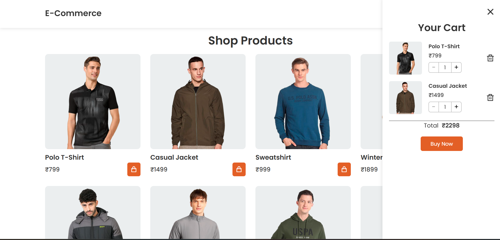

# 🛍️ E-Commerce Shopping Cart

A responsive and interactive E-Commerce Shopping Cart website built using **HTML, CSS, and JavaScript**. This project demonstrates essential shopping cart functionality, including adding products, managing quantities, removing items, and automatically calculating the total price.

## 🚀 Live Demo

🔗 **Live Website:** [Add your deployed website link here]

## 📸 Project Preview

<!-- Add your project screenshot here -->


## ✨ Features

- **Product Listing:** Display multiple men's fashion products with images, names, and prices.
- **Add to Cart:** Add products to the shopping cart with a single click.
- **Duplicate Prevention:** Prevent adding the same product multiple times.
- **Shopping Cart Sidebar:** Open and close the cart using interactive controls.
- **Quantity Management:** Increase or decrease product quantities.
- **Remove Products:** Remove individual products from the cart.
- **Cart Counter:** Display the total number of items in the cart.
- **Automatic Price Calculation:** Dynamically calculate the total cart amount based on product prices and quantities.
- **Buy Now:** Simulate a purchase and clear the shopping cart.
- **Responsive Product Grid:** Display products in a flexible grid layout.

## 🛠️ Technologies Used

| Technology | Purpose |
|---|---|
| HTML5 | Website structure |
| CSS3 | Styling, layouts, and animations |
| JavaScript (Vanilla JS) | Shopping cart functionality and DOM manipulation |
| Remix Icon | Shopping cart and interface icons |
| Google Fonts | Poppins typography |

## 📂 Project Structure

```text
Ecommerce-Shopping-Cart/
│
├── index.html
├── style.css
├── script.js
│
├── images/
│   ├── product1.jpg
│   ├── product2.jpg
│   ├── product3.jpg
│   ├── product4.jpg
│   ├── product5.jpg
│   ├── product6.jpg
│   ├── product7.jpg
│   ├── product8.jpg
│   └── preview.png
│
└── README.md
```

## ⚙️ Getting Started

Follow these steps to run the project locally.

### 1. Clone the Repository

```bash
git clone https://github.com/ravi-kumar-joshi/E-commerce_Website_Shopping_Cart
```

### 2. Navigate to the Project Folder

```bash
cd Ecommerce Website Shopping Cart
```

### 3. Run the Project

Open `index.html` in your browser.

You can also use the **Live Server** extension in VS Code for a better development experience.

## 🧠 Key JavaScript Concepts Practiced

This project helped me understand and practice:

- DOM Manipulation
- Event Listeners
- Event Delegation Concepts
- `querySelector()` and `querySelectorAll()`
- `createElement()` and `appendChild()`
- `classList.add()` and `classList.remove()`
- `closest()` method
- Array and NodeList iteration
- Dynamic HTML rendering
- Template Literals
- Conditional Statements
- Functions and State Management

## 🔮 Future Improvements

- [ ] Store cart items using Local Storage.
- [ ] Add product search functionality.
- [ ] Add product category filters.
- [ ] Implement a checkout page.
- [ ] Add product size selection.
- [ ] Improve mobile responsiveness.
- [ ] Integrate a backend and database.
- [ ] Add user authentication.

## 👨‍💻 Author

**Ravi Kumar**

Full-Stack Developer | BCA Graduate

- GitHub: [@ravi-kumar-joshi](https://github.com/ravi-kumar-joshi)

---

⭐ If you like this project, consider giving it a star!

**Built with ❤️ using HTML, CSS & JavaScript.**